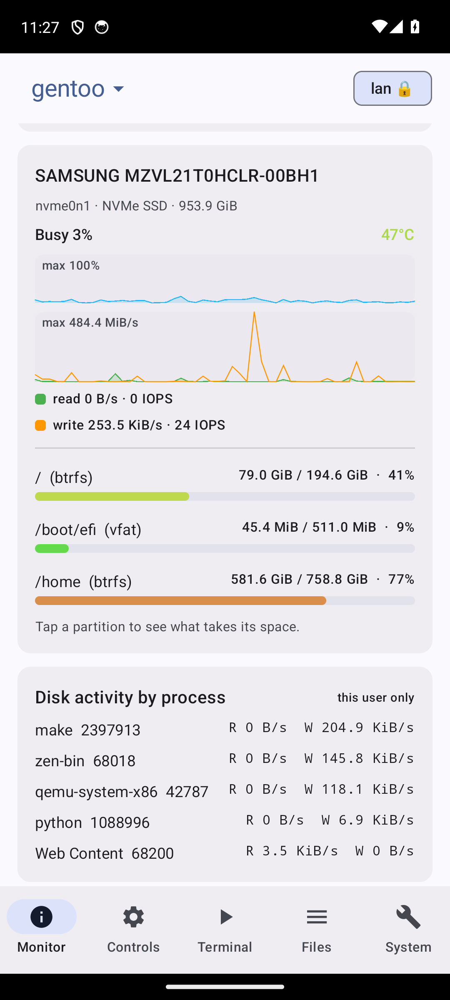
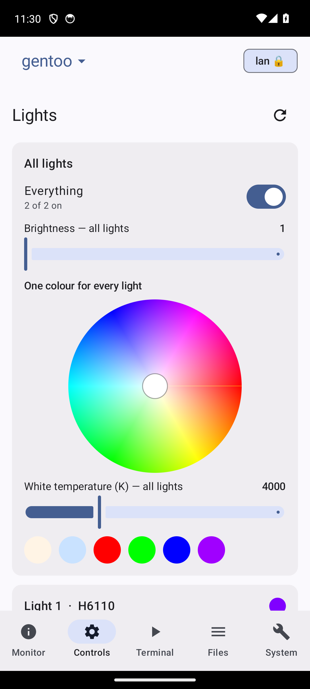
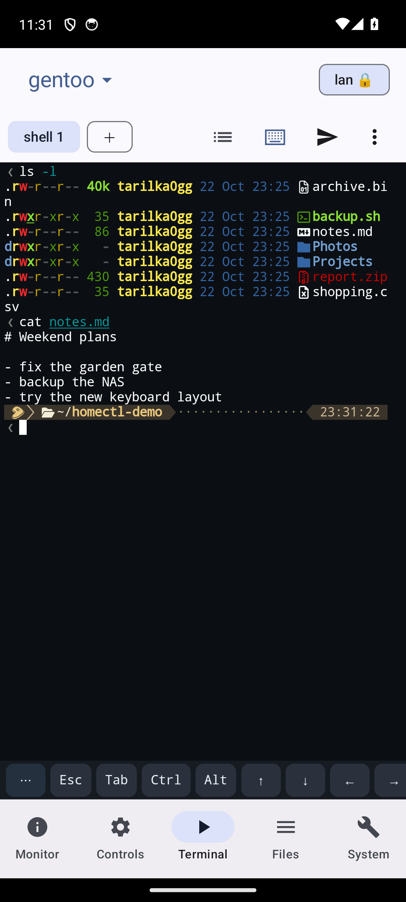
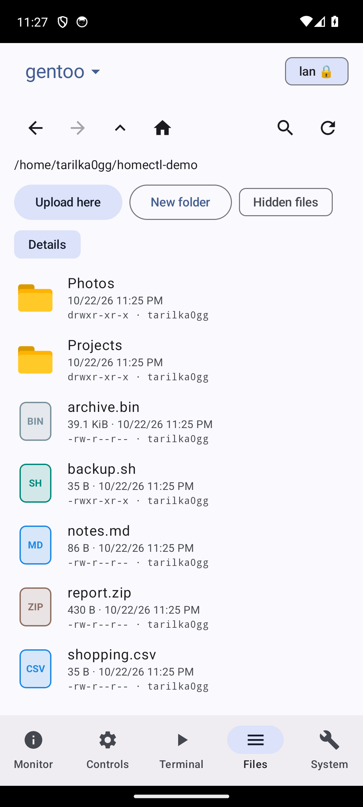

# homectl

[](https://github.com/tarilka0gg/homectl/actions/workflows/ci.yml) [](LICENSE) [](CHANGELOG.md)

Control your own computers and smart home from your phone. A small daemon runs on each machine; a native
Android app (Material 3) finds them, pairs with a 6-digit code and gives you a live system monitor, files,
a terminal that keeps running, audio, power controls, lights and a shared clipboard. It reaches the machines over
your Wi-Fi, Tailscale or, when you are away from home, a tunnel that only a phone you registered can use.

> **homectl gives whoever controls it a shell, your files and power control.** Read [SECURITY.md](SECURITY.md) and
> [docs/AWAY.md](docs/AWAY.md) before you turn the tunnel on. There is no account and no hosted service: the daemon and the app talk to each other.

| Tab | What it does |
|---|---|
| **Monitor** | btop-style live view: CPU (per-core load, temperature, clocks, governor, throttling), every GPU, memory and swap, **per-disk activity** (busy %, read/write, IOPS, temperature, partitions, the processes using the disk, and a fast "what takes the space" view with open and delete), network, battery health and power draw, pressure (PSI), every hwmon sensor, fans and a sortable, searchable process table with terminate / kill / pause. Several machines side by side |
| **Controls** | Screens off/on and **brightness for every screen** (built-in panel and DDC/CI monitors), Govee lights with a **colour wheel** and white temperature (per light and for all), Wi-Fi, Bluetooth, airplane mode, a per-device and **per-app audio mixer**, webcam controls, the public-tunnel switch |
| **Terminal** | A real shell (xterm.js) that **keeps running on the machine**: leave, close the app, lose Wi-Fi, and reattach to the same screen. Pick the shell, several sessions, split view, key rows, scrollback buffer, an SSH shortcut |
| **Windows** | What is open on the machine's desktop, as **data rather than pixels**: title, app and icon for every window (any compositor with the wlroots foreign-toplevel protocol), bring to front and close. Terminals started through `homectl-pty` are **mirrored live** (real text, colours, scrollback) and you can type into them. See [docs/WINDOWS.md](docs/WINDOWS.md) |
| **Files** | Thumbnails and icons, **a path you can type**, **search**, back / forward (gestures too), **a preview for every type** (images, text, PDF, video, audio, hex), **text editing**, rename, delete, upload, look inside archives and unzip, and **details** (owner, permissions, dates, checksums, image size). The machines also appear in Android's own file picker |
| **System** | Power modes (your own on/off scripts), services, lock / suspend / reboot / power off, a **clipboard** with pickers to send and get (text *and* pictures, plus Noctalia's history) and an optional **common clipboard** as a background service, send files, a connection test and the **Security** section |

## Screenshots

<table>
  <tr>
    <td width="50%"><a href="docs/img/monitor.png"></a></td>
    <td width="50%"><a href="docs/img/controls.png"></a></td>
  </tr>
  <tr>
    <td><b>Monitor</b><br><sub>One card per disk: how busy it is, read and write graphs with IOPS, temperature, the partitions (tap one to see what fills it) and which processes are using it.</sub></td>
    <td><b>Lights</b><br><sub>A colour wheel for each light and one for all of them, plus brightness and white temperature.</sub></td>
  </tr>
  <tr>
    <td width="50%"><a href="docs/img/terminal.png"></a></td>
    <td width="50%"><a href="docs/img/files.png"></a></td>
  </tr>
  <tr>
    <td><b>Terminal</b><br><sub>A real shell with the prompt's symbols drawn correctly. The session lives on the machine, so it is still there when you come back.</sub></td>
    <td><b>Files</b><br><sub>Type a path, search, go back and forward; icons by type and, with Details on, the permissions and owner of each entry.</sub></td>
  </tr>
</table>

<sub>The Android app in an emulator, connected to a laptop over the home network; the files are made-up demo files. Click a picture to see it full-size.</sub>

## Install

Releases are on the **[Releases page](../../releases/latest)**:

| File | What it is |
|---|---|
| `homectl-x.y.z.apk` | The Android app (Android 8 or newer) |
| `homectl-linux-x86_64` | The daemon: a static binary that runs on any x86-64 Linux |
| `homectl-pty` | The wrapper that mirrors a terminal window to the Windows tab (static, x86-64 Linux) |
| `homectl-adopt` | Optional helper that moves terminals that were already open into the wrapper (see [docs/WINDOWS.md](docs/WINDOWS.md)) |
| `homectl-send-android-arm64` | A tiny file uploader for Termux and ARM |
| `SHA256SUMS` | Checksums |

```
chmod +x homectl-linux-x86_64
./homectl-linux-x86_64              # HTTP and HTTPS on port 7878
./homectl-linux-x86_64 pair         # a homectl://pair… link and a QR code, plus any pairing request waiting for a code
./homectl-pair                # the same, in a window (build: cargo build --release --features gui --bin homectl-pair; needs GTK 4 and qrencode). Shows the QR code and link only when you press Show
```

It uses `brightnessctl`, `wpctl` / `pactl`, `nmcli`, `bluetoothctl`, `ddcutil`, `wl-clipboard`, `loginctl` and `doas` when they are there;
a feature whose tool is missing does not appear. To start it at boot on OpenRC (with the tunnel on by default): `doas sh packaging/install-service.sh [USER] [PATH-TO-homectl]`.

Open the `.apk` on the phone (allow "install unknown apps" once). The app lists the machines it finds on the network; tap **Pair**
and type the 6-digit code the machine shows. **Then open the app once on the home network:** that is when the phone registers its
key with the machine, learns its tunnel and relays, and pins its certificate.

The APK is signed with APK Signature Scheme v2 + v3. The certificate fingerprints are in [docs/SIGNING.md](docs/SIGNING.md); check with
`apksigner verify --print-certs homectl-x.y.z.apk`. That page also explains the Play Protect "unrecognized app" warning.

## Reaching it from anywhere

The app keeps every address a machine reports and tries **all of them at once**, taking the best answer:

1. **LAN**: the same Wi-Fi.
2. **Tunnel**: an outbound Cloudflare quick tunnel the daemon opens (`HOMECTL_TUNNEL=quick`, or `auto` to keep it off while a server that relays to the machine is up; needs `cloudflared` next to the binary or on `PATH`). It needs no router settings and works behind carrier-grade NAT. The tunnel's address changes on every restart, so the daemon announces it on a private [ntfy](https://ntfy.sh) topic, signed with the machine's token, and the app finds it there.
3. **Through another machine**: an always-on machine with a tunnel relays to your others (set up automatically once both are paired).
4. **Tailscale / Headscale**: the last fallback.

What each third party can see is in [docs/AWAY.md](docs/AWAY.md).

## Security model

- Every request needs the machine's **access token** (24 random bytes, mode 600).
- On the LAN, Tailscale and the relay the app uses **HTTPS with the certificate it pinned at pairing**: the daemon makes its own self-signed certificate, so there is no CA and no account. "Refuse plain connections" is optional.
- **Through the tunnel a request must also be signed by a registered phone.** Each phone has a key in its secure hardware that never leaves it, registered once on the home network; every tunnel request carries a one-time signature over its method, path and query. A leaked token alone is refused, and so is a replayed request.
- The app **locks behind your fingerprint, face or screen lock**, keeps tokens and your `doas` password in the Android Keystore, and can hide itself from screenshots.
- Root actions (power modes, services, restart) use **your own `doas` password**, typed into a private terminal and never stored or logged by the daemon.

Switches: `HOMECTL_NO_TERMINAL=1`, `HOMECTL_NO_DELETE=1`, `HOMECTL_NO_EDIT=1`, `HOMECTL_TUNNEL=off|quick|auto`, `HOMECTL_NO_RENDEZVOUS=1`, `HOMECTL_ADDR=host:port`, `HOMECTL_DRYRUN=1` (power actions only log).

## Notes

* An NVIDIA dGPU is read with `nvidia-smi` **only while it is already awake and the laptop is on AC**; asking a sleeping card wakes it. Intel and AMD GPUs are read from sysfs.
* CPU package power needs read access to `/sys/class/powercap/intel-rapl:*/energy_uj`, which Linux makes root-only; the app offers to allow it until the next reboot.
* Govee lights need **LAN Control** switched on for each light in the Govee app. Lights that have none (some bulbs, e.g. H6009) can be driven through Govee's cloud instead: in the Govee Home app open Profile → Settings → Apply for API Key, then paste the key under Controls → Lights → Govee cloud. The key stays on the machine and goes only to Govee; the cloud allows about 10 commands a minute per light, and needs `curl` on the machine.
* Power modes are `<name>-on.sh` + `<name>-off.sh` pairs in your home, `~/.local/bin` or `/usr/local/bin`, or entries in `~/.config/homectl/actions.json` (see `docs/actions.example.json`). They run through `doas`.
* Android lets an app read the phone's clipboard only while it is in front, so the common clipboard sends the phone's copies automatically while homectl is open; with it closed, use the **Send clipboard** button in the notification or the quick-settings tile.
* The tunnel's TLS ends at Cloudflare, which can see that traffic; the certificate pinning covers the other routes. Request bodies are not signed (they travel inside TLS). A compromised, unlocked phone can still sign requests.
* Most behaviour was verified on one laptop (Gentoo, OpenRC, niri) and an Alpine server. The app was exercised in an emulator; **fingerprint and face unlock, the quick-settings tile and a reboot of the clipboard service were only tried with the screen-lock PIN or not at all.** Free quick tunnels come with no uptime promise.

## Build

Needs Rust for the daemon; the app needs JDK 17 and Android SDK platform 34 with build-tools 34.0.0.

```
cargo build --release && cargo test --release          # the daemon (needs a C compiler)
packaging/build-static.sh                              # portable static musl build (zig and the official rustc)
(cd zig && zig build -Doptimize=ReleaseSmall)          # homectl-send, homectl-pty and homectl-adopt (zig test pty.zig runs its tests)
(cd android && ./gradlew :app:assembleRelease)         # the app
```

Without a keystore the app is signed with the Android debug key; set `HOMECTL_KEYSTORE` (and `HOMECTL_KEYSTORE_PASS`, `HOMECTL_KEY_ALIAS`,
`HOMECTL_KEY_PASS`) to use your own. See [CONTRIBUTING.md](CONTRIBUTING.md). The code is laid out as:

| path | role |
|---|---|
| `src/` | the Rust daemon (axum): monitor, files, terminal, clipboard, relay, device keys, TLS |
| `csrc/`, `zig/` | C shims (V4L2 webcam, PTY) and the Zig uploader and terminal mirror (`homectl-pty`) |
| `android/` | the Kotlin + Compose app |
| `packaging/` | the OpenRC service, the static build and the release-signing script |
| `docs/` | the away-from-home design, signing notes, screenshots |

## Changelog

What changed in each version is in [CHANGELOG.md](CHANGELOG.md).

## License

GPL-2.0-or-later, see [LICENSE](LICENSE). Bundled third-party code (xterm.js, Symbols Nerd Font) and the dependencies are listed in
[THIRD_PARTY_NOTICES.md](THIRD_PARTY_NOTICES.md).
